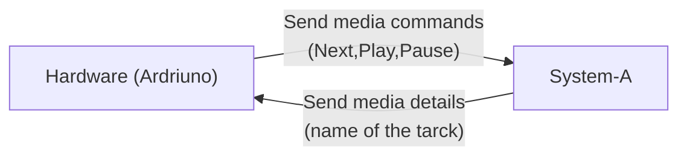

# Music control system using Arduino 

# Features 
## Battery level indicator 
**Mean**:- Battery to be displayed using 4 led sequence 
Requirements: 
- 4x Leds 
- Charging Module 
## Media Name display 
**Mean**:- Display Media name over Bluetooth
Requirements:
- LCD 
## Media Control
**Mean:**- Control media using hardware means 
Requirements:- 
- 3x Tactile buttons 

## Complete System 
**Mean**:- A complete hub that will integrate all these features together into one system 
Requirements:- 
- A brain (ardriuno)
- Battery set 
- A charging module
- A breadboard 
- A Bluetooth Module

# Plan 
## Implement in chucks 
Firstly work on the main logic 
- find how to read media 
- how to send it over the BT 
- display it on the LCD 

I plan to make a two component system 
- one runs on my host system and the other on the ardriuno 
- Ardriuno talks to the `Sys-A` and this `Sys-A` talks to the system.

